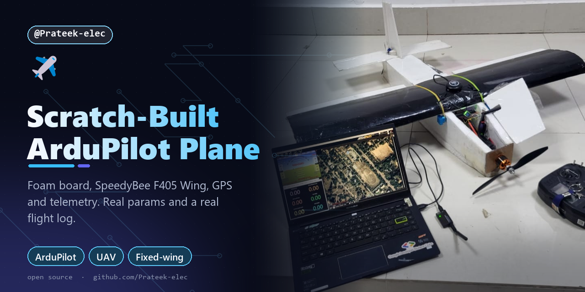
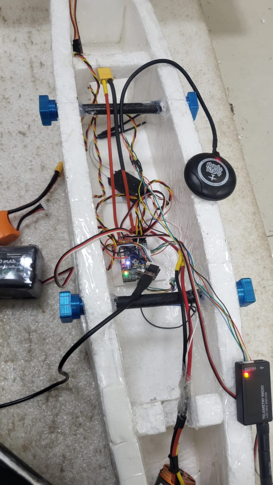
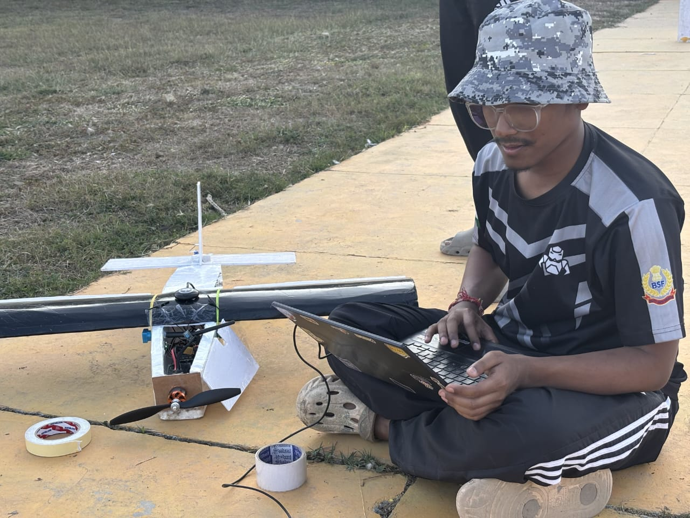
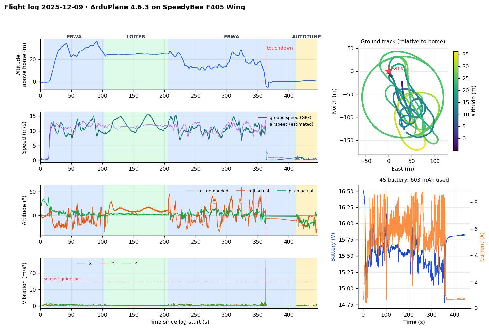

**A foam-board fixed-wing UAV built from scratch and flown on ArduPilot: SpeedyBee F405 Wing flight controller, GPS, 433 MHz telemetry and Mission Planner. Full parameter file and a real flight log included.**

---

## Highlights

- ✈️ **Scratch-built from foam board:** no kit, no shortcuts.
- 🧭 **Real autopilot:** ArduPilot on a SpeedyBee F405 Wing with GPS and 433 MHz telemetry.
- 📊 **Real data:** the full parameter file and an actual DataFlash flight log.
- 🎓 **Learn by copying:** load the params, open the log, see how it was tuned.

## The build

A hand-built foam-board airframe (high wing, conventional tail) turned into a GPS-capable UAV. Everything here (the parameters and the DataFlash log) is real data from this aircraft, so you can reproduce the setup or learn how to read ArduPilot logs.

<table>
<tr>
<td width="50%"> Airframe, top view</td>
<td width="50%"> At the field</td>
</tr>
<tr>
<td width="50%"> Avionics bay: FC, ESC, GPS, 433 MHz telemetry radio</td>
<td width="50%"> Field tuning in Mission Planner</td>
</tr>
</table>

## Hardware

| Part | Details |
|---|---|
| Flight controller | **SpeedyBee F405 Wing** running **ArduPilot Plane** |
| Radio | **RadioMaster** transmitter, with mode switching on a switch |
| GPS | **Ready To Sky** GPS module (with compass) |
| Telemetry | **433 MHz** telemetry radio pair to the ground station |
| Propulsion | **1000 KV** brushless motor, ESC, 2-blade prop |
| Airframe | Scratch-built foam board, with carbon spars and bolt-on wings |
| Ground station | Mission Planner on a laptop |

## What's in the repo

| File | What it's for |
|---|---|
| [`ardupilot/log_plane.param`](ardupilot/log_plane.param) | The full ArduPilot parameter set for this airframe. Load it in Mission Planner via **Config → Full Parameter List → Load from file**. |
| [`logs/2025-12-09_17-05-20.bin`](logs/2025-12-09_17-05-20.bin) | A DataFlash flight log. Open it in Mission Planner (**Ctrl+F → Review a Log**) or in [UAV Log Viewer](https://plot.ardupilot.org/). |
| `docs/images/` | Build photos |

## What I did

- Designed and built the airframe
- Integrated the FC, GPS, telemetry and power system
- Calibrated the radio and mapped flight modes
- Configured and tuned ArduPilot parameters
- Ran ground tests and verified everything in Mission Planner
- Logged flight data for analysis

## Flight log analysis

Plotted from [`logs/2025-12-09_17-05-20.bin`](logs/2025-12-09_17-05-20.bin) with pymavlink. The ground track is shown relative to home.

| | Result |
|---|---|
| **Flight** | About 6 minutes airborne, 3.9 km flown, up to 36 m above home and 187 m away |
| **Speed** | Cruise around 11–12 m/s, peak ground speed 15.6 m/s (56 km/h) |
| **Modes** | Took off and climbed out in **FBWA**, held position in **LOITER** for 100 s, then flew FBWA circuits and landed |
| **Loiter** | Held 24–25 m above home, within about ±1 m, for the whole 100 s |
| **Attitude tracking** | Roll followed the demand with 5.8° RMS error, pitch 3.5° (in flight) |
| **Vibration** | Peak 8.8 m/s² in flight (mean Z 1.3 m/s²), far below the 30 m/s² guideline. All 13 accelerometer clips happened at the touchdown impact |
| **Power** | 4S pack: 16.5 V → 15.8 V at rest, lowest 14.8 V under load, about 6 A average, 603 mAh used |

**Takeaways:** the airframe flies cleanly on this tune, the FC mounting gives low vibration, and the battery had plenty in reserve. AUTOTUNE was armed on the ground after landing, so this log has no AutoTune data. That's the next flight.

## Next steps

- [ ] Vibration isolation and cleaner cable management
- [ ] Failsafe tuning (RC loss, GPS loss, low battery)
- [x] LOITER tested (held altitude within ±1 m)
- [x] Flight log analysis write-up
- [ ] AutoTune flight
- [ ] Autonomous mission tests: AUTO, RTL
- [ ] Flight video

## Safety

Fly within local regulations, away from people, with a working failsafe. Bench-test with the propeller removed.

## License

[MIT](LICENSE) © Prateek Sarkar

---

### Found this useful?

**Drop a ⭐ so more builders find it, and share it with someone who'd build one.**

