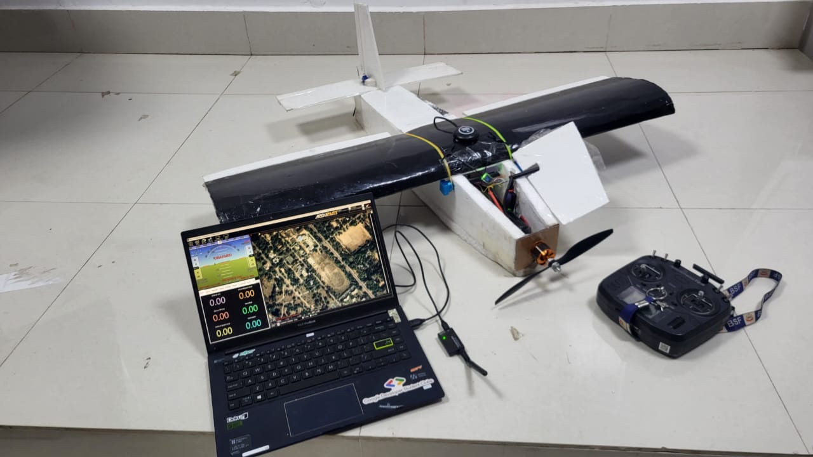
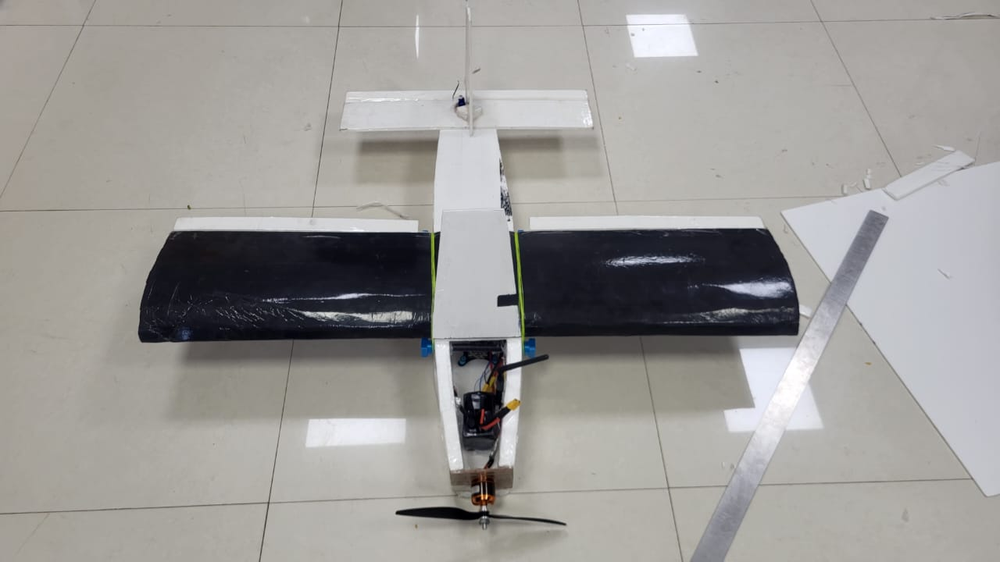
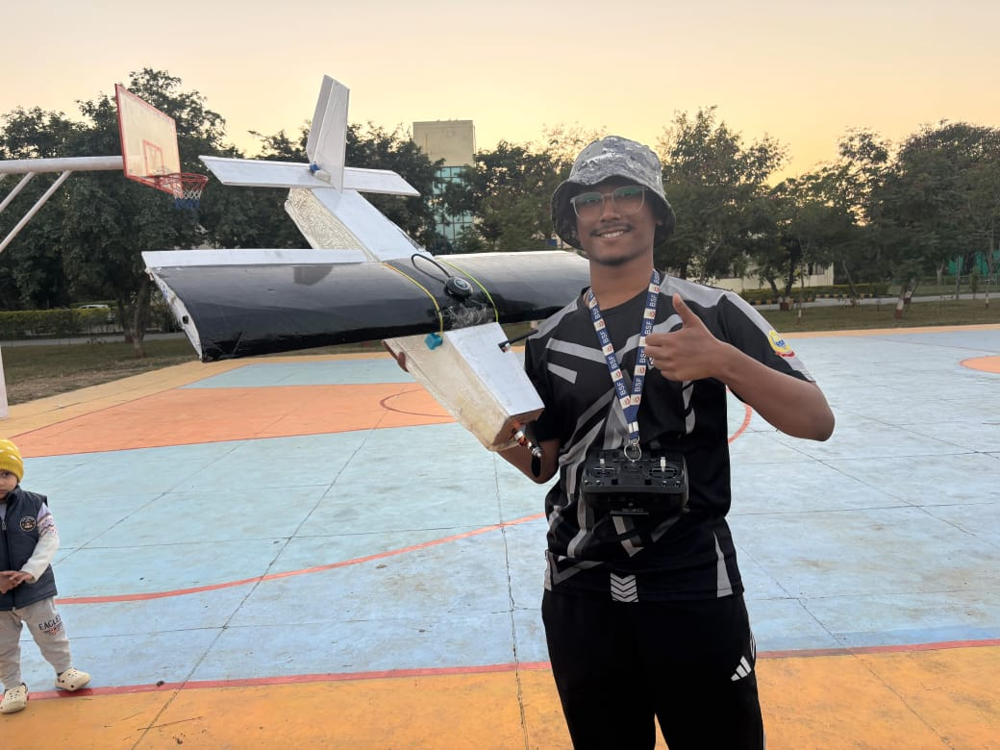

# Scratch-Built ArduPilot RC Plane

**A foam-board fixed-wing UAV built from scratch and flown on ArduPilot: SpeedyBee F405 Wing flight controller, GPS, 433 MHz telemetry and Mission Planner. Full parameter file and a real flight log included.**

---

## The build

A hand-built foam-board airframe (high wing, conventional tail) turned into a GPS-capable UAV. Everything here (the parameters and the DataFlash log) is real data from this aircraft, so you can reproduce the setup or learn how to read ArduPilot logs.

<table>
<tr>
<td width="50%"> Airframe, top view</td>
<td width="50%"> At the field</td>
</tr>
<tr>
<td width="50%"> Avionics bay: FC, ESC, GPS, 433 MHz telemetry radio</td>
<td width="50%"> Field tuning in Mission Planner</td>
</tr>
</table>

## Hardware

| Part | Details |
|---|---|
| Flight controller | **SpeedyBee F405 Wing** running **ArduPilot Plane** |
| Radio | **RadioMaster** transmitter, with mode switching on a switch |
| GPS | **Ready To Sky** GPS module (with compass) |
| Telemetry | **433 MHz** telemetry radio pair to the ground station |
| Propulsion | **1000 KV** brushless motor, ESC, 2-blade prop |
| Airframe | Scratch-built foam board, with carbon spars and bolt-on wings |
| Ground station | Mission Planner on a laptop |

## What's in the repo

| File | What it's for |
|---|---|
| [`ardupilot/log_plane.param`](ardupilot/log_plane.param) | The full ArduPilot parameter set for this airframe. Load it in Mission Planner via **Config → Full Parameter List → Load from file**. |
| [`logs/2025-12-09_17-05-20.bin`](logs/2025-12-09_17-05-20.bin) | A DataFlash flight log. Open it in Mission Planner (**Ctrl+F → Review a Log**) or in [UAV Log Viewer](https://plot.ardupilot.org/). |
| `docs/images/` | Build photos |

## What I did

- Designed and built the airframe
- Integrated the FC, GPS, telemetry and power system
- Calibrated the radio and mapped flight modes
- Configured and tuned ArduPilot parameters
- Ran ground tests and verified everything in Mission Planner
- Logged flight data for analysis

## Next steps

- [ ] Vibration isolation and cleaner cable management
- [ ] Failsafe tuning (RC loss, GPS loss, low battery)
- [ ] Autonomous mission tests: AUTO, RTL, LOITER
- [ ] Flight video + log analysis write-up

## Safety

Fly within local regulations, away from people, with a working failsafe. Bench-test with the propeller removed.

## License

[MIT](LICENSE) © Prateek Sarkar

**First ArduPilot plane? Grab the params, and leave a ⭐ if they helped.**

